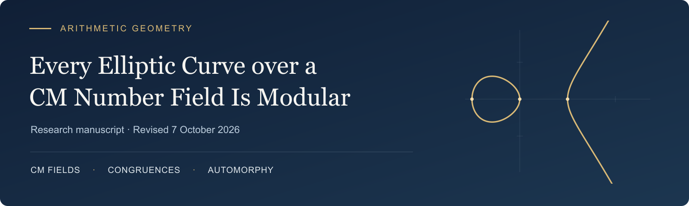

**[Read the manuscript](elliptic-curves-cm-modularity.pdf)** · **[LaTeX source](elliptic-curves-cm-modularity.tex)** · [Build instructions](#build-from-source)

*Revised 7 October 2026 · 15 pages · 15 numbered results · 12 references*

## Overview

This manuscript presents an argument for the modularity of every elliptic curve over a CM number field. It combines a geometric covering construction with automorphy lifting in characteristic five, retaining a Steinberg place to address exceptional residual cohomology. A suitable specialization produces a modular auxiliary elliptic curve and three congruences, in characteristics **p, 3, and p**, connecting it to the prescribed curve. The construction includes non-Galois CM fields and fields containing fifth roots of unity.

The PDF contains the full argument and bibliography. The standalone LaTeX source reproduces its equations, numbered statements, and linked references.

## Reading guide

| Section | Main step |
| :--- | :--- |
| **1 · Introduction** | The main theorem, normalization conventions, and the congruence strategy. |
| **2 · The geometric congruence construction** | Covering families, compatible systems, local conditions, and simultaneous specialization. |
| **3 · A Steinberg place in characteristic five** | The local deformation condition and exclusion of exceptional cohomology classes. |
| **4 · Automorphy lifting with a retained Steinberg place** | Integral Hecke maps, Taylor–Wiles presentations, and the lifting theorem. |
| **5 · Constructing the modular auxiliary curve** | The width-three degeneration, modular source, and preparation of the field. |
| **6 · Completion of the proof** | Propagation through the congruence chain, compatible systems, and solvable descent. |

## Review status

The manuscript received an AI-assisted internal mathematical audit, clarifying revisions, and a further team review. **No further gaps were identified in that review, assuming the correctness and applicability of the cited external inputs.** This assessment does not constitute formal verification or independent peer review.

The revisions expand the Hecke-algebra comparisons, the compatibility of patching presentations with reduction and augmentation, the degeneration argument, and the field preparation. All 15 rendered pages were inspected, and theorem numbering and internal references were checked.

## Build from source

Use a TeX Live or MiKTeX installation with pdfLaTeX and the packages listed in the source preamble, including `newtxtext` and `newtxmath`.

From the repository folder, run:

```sh
pdflatex -interaction=nonstopmode -halt-on-error elliptic-curves-cm-modularity.tex
pdflatex -interaction=nonstopmode -halt-on-error elliptic-curves-cm-modularity.tex
```

Alternatively, with `latexmk` installed:

```sh
latexmk -pdf -interaction=nonstopmode -halt-on-error elliptic-curves-cm-modularity.tex
```

The bibliography is embedded in the source. No BibTeX, Biber, external figures, or shell escape is required. The `.gitignore` excludes temporary LaTeX files while retaining the compiled PDF.

## Principal inputs

The complete bibliography and precise theorem references appear in the manuscript. Its principal geometric and automorphy inputs include:

- **OpenAI**, *Modularity of elliptic curves over imaginary quadratic fields* (4 October 2026), at the [repository commit used in the manuscript](https://github.com/openai/math/blob/adc7f1241b42e322a6451854ab7e4b4c146bf78a/preprints/Modularity-of-elliptic-curves-over-imaginary-quadratic-fields-October-4-2026/paper.pdf).
- **Ana Caraiani and James Newton**, [*On the modularity of elliptic curves over imaginary quadratic fields*](https://arxiv.org/html/2301.10509v3), version 3.
- **Allen et al.**, [*Potential automorphy over CM fields*](https://doi.org/10.4007/annals.2023.197.3.2).
- **Patrick B. Allen, Chandrashekhar Khare, and Jack A. Thorne**, [*Modularity of GL₂(Fₚ)-representations over CM fields*](https://arxiv.org/abs/1910.12986v2).

## Mathematical feedback

Corrections and questions can refer to a numbered theorem, lemma, proposition, or a specific passage. For a proposed gap, state the inference in question and which additional hypothesis or argument would be needed.
